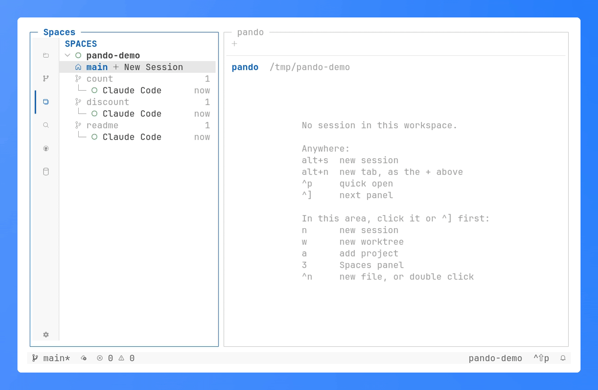
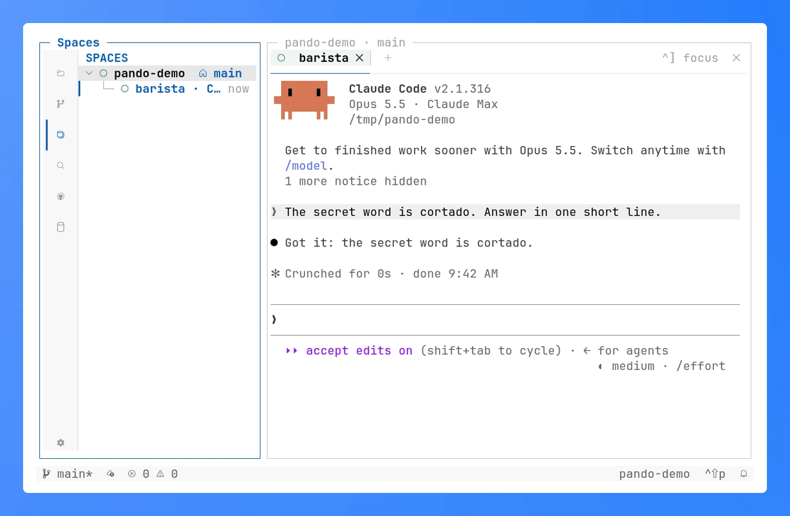
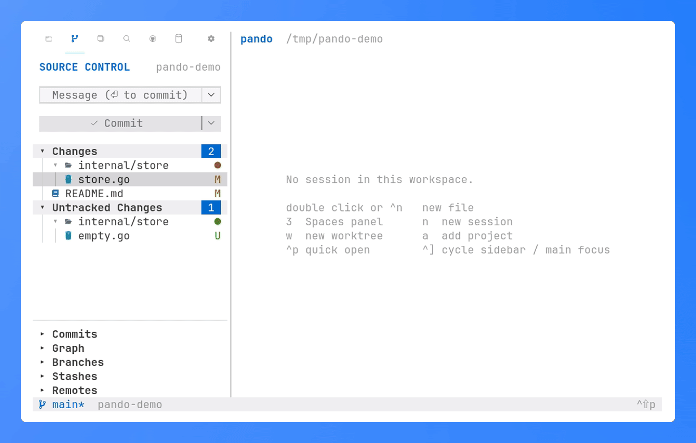
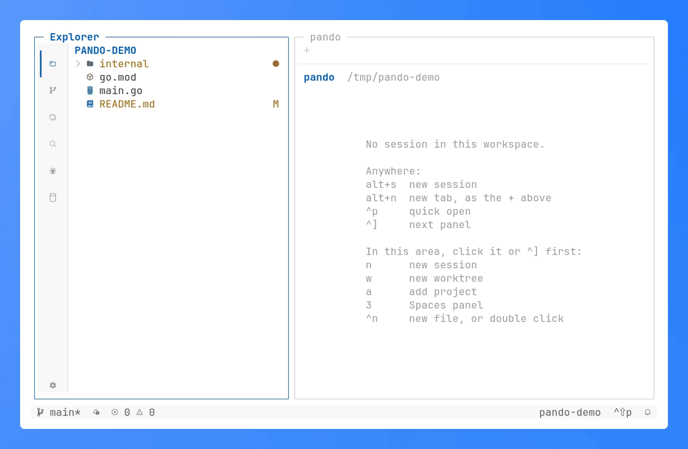
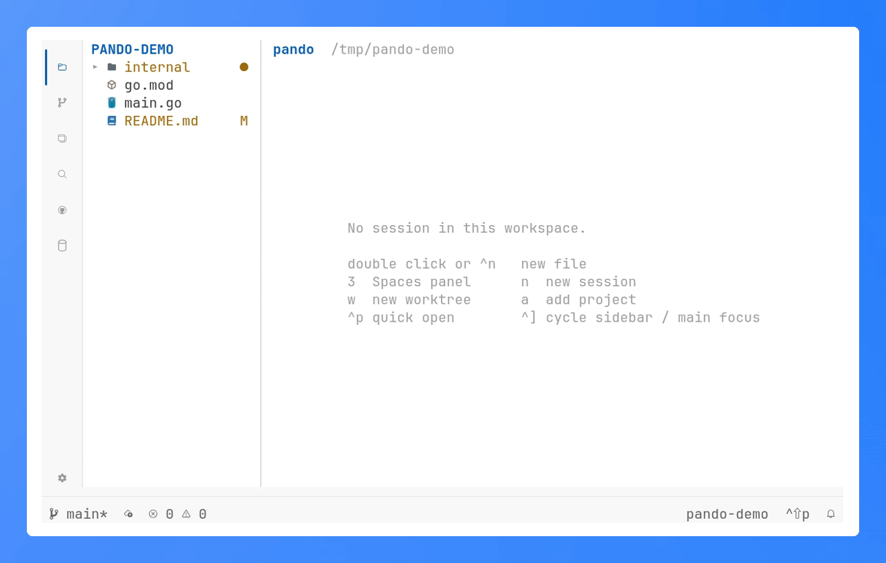
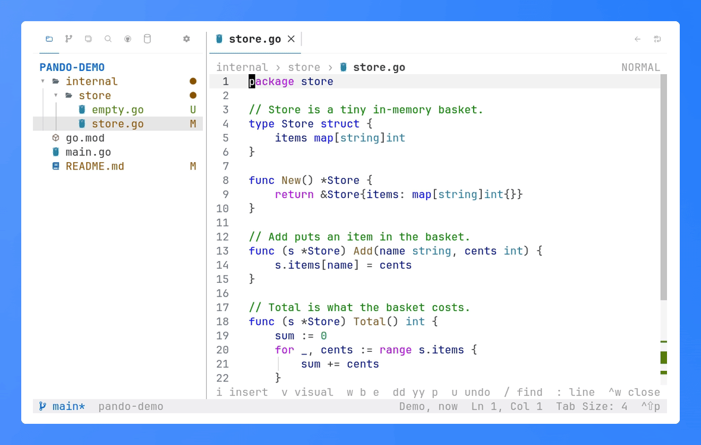
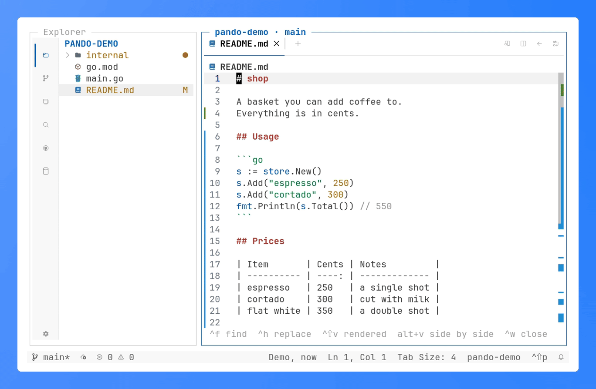
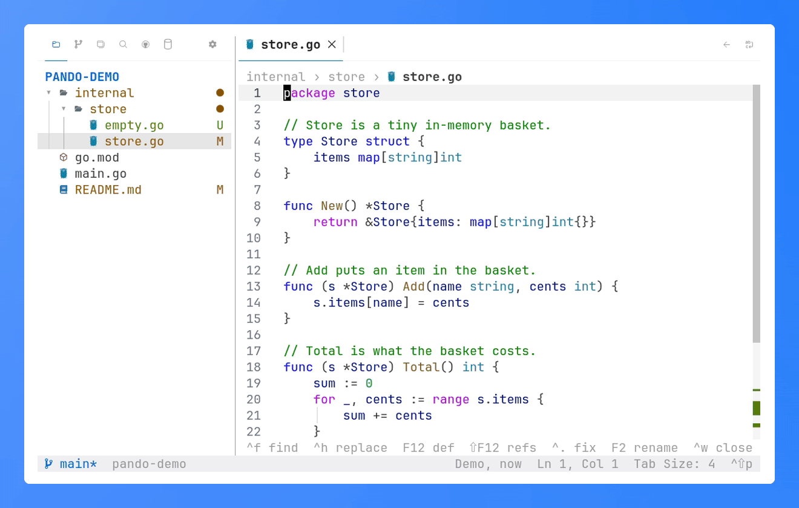
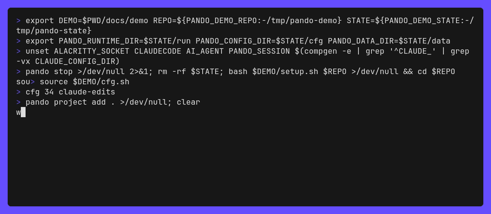

# Using pando

The user guide. Settings: [06-config.md](06-config.md); keys:
[09-keys.md](09-keys.md).

- [Projects, worktrees, sessions](#projects-worktrees-sessions)
- [The screen](#the-screen)
- [Sessions](#sessions)
- [Resume](#resume)
- [Review and commit](#review-and-commit)
- [GitHub](#github)
- [Editor](#editor)
- [Settings, keys, updates](#settings-keys-updates)
- [CLI](#cli)
- [Files](#files)

## Projects, worktrees, sessions

Spaces (`3`) is a tree: projects you added, their worktrees, and the
sessions in each worktree.

```text
app                      project: pando ~/code/app, or `a` in Spaces
├─ ⌂ main                its own checkout
│  ├─ ○ shell            session: idle
│  └─ ◐ claude           session: working
└─ ⑂ feat-login          linked worktree, `w`
   └─ × claude           session: waits for you
```

| Key      | In Spaces                                                       |
| -------- | --------------------------------------------------------------- |
| `w`      | add a worktree to the selected project                          |
| `n`      | start an agent or a terminal in the worktree, or a row's `+`    |
| `x`      | kill a session, delete a worktree, or close a project           |
| `o`      | filter, sort and group the list                                 |
| `alt+↑↓` | reorder sessions and worktrees                                  |

A session runs an agent: the picker lists the installed `[agents]` presets
(claude, codex, gemini, opencode, …), then _terminal_, a plain shell. An
agent with profiles asks which one next: _default_, the `[profiles]` in
`config.toml`, then every config pando saw it run in, such as a claude
started as `CLAUDE_CONFIG_DIR=~/.claude-work claude` in a session.

```toml
[profiles.claude]
work = ["CLAUDE_CONFIG_DIR=~/.claude-work"]

[profiles.codex]
client = ["CODEX_HOME=~/codex-client"]
```

A project's `+` asks for one of its worktrees, or a new one, first. The agent exiting closes its session;
a failure stays listed as `exit N`.

Deleting a worktree keeps its branch; closing a project never removes its
checkout.

## The screen

```text
┌────────┬────────────────┬──────────────────────┬──────────────────┐
│ SPACES │ Files Git ⌕    │ main.go │ notes.md   │ claude           │
│ ▾ app  │ ▾ src          │                      │                  │
│  ⌂ main│    main.go   M │   editor or diff     │   session        │
│   ◐ fix│                │                      │   (its own PTY)  │
│  ⑂ feat│                ├──────────────────────┤                  │
│   × ui │                │ Terminal panel       │                  │
├────────┴────────────────┴──────────────────────┴──────────────────┤
│ status bar: branch, sync, agents waiting, updates                 │
└───────────────────────────────────────────────────────────────────┘
```

- `ctrl+]` cycles focus; inside a session every other key goes to its program.
- `1`–`4` and `6` open Explorer, Source Control, Spaces, Search and GitHub.
- ``ctrl+` ``, `ctrl+j` or `5` toggles the Terminal panel; `ctrl+shift+↑`
  maximizes it.
- A session beside a file: the button at the right end of either's tab strip
  maximizes it over the whole editor area, and restores the pair. Each
  worktree keeps it while you are in another.
- Drag a view's tab to move it, a divider to resize. A second click on the
  open view's icon hides its sidebar; `ctrl+b` hides both.
- Rest the pointer on an icon button for its name and key. A view's header
  buttons show while the pointer is over the view.

## Sessions

- A session opens in a column beside the editor. Drag it to the other side,
  over the editor, or off screen to hide it; it keeps running.
- A session re-roots Explorer and Source Control to its worktree.
- Each session has shell tabs (the strip's `+`) and its own Terminal panel.
  `[` `]` step through its tabs; `alt+t` picks a session. Spaces shows the
  tab count (`⧉ 2`) on a session with more than one.
- Drag over a terminal to select and copy; `ctrl+f` finds in its scrollback.

| Mark | State     | Means                                                     |
| ---- | --------- | --------------------------------------------------------- |
| `×`  | `blocked` | waits for you: a permission or a question                 |
| `◐`  | `running` | works                                                     |
| `◐`  | `shell`   | running a shell command, in the background too (blue)     |
| `✓`  | `done`    | finished, not looked at yet                               |
| `○`  | `idle`    | at its prompt                                             |
| `✕`  | `exited`  | failed (`exit N`); a clean exit closes the session        |

One needing you pulses until clicked (`session_highlight`) and can
play a sound (`sounds`).



## Resume

After a daemon restart pando types into each session's shell what resumes
its agent: `claude --resume` with its conversation id (`claude --continue`
without one), `codex resume --last`, `opencode --continue`. Others take one
line:

```toml
[resume]
aider = ["aider", "--restore-chat-history"]
```

- A conversation still open elsewhere is not opened twice.
- A custom config dir (`CLAUDE_CONFIG_DIR`, `CODEX_HOME`) comes back with it.
- Scrollback is not kept, and what ran in the terminal stops, subagents
  included. `pando claude` starts claude as a Claude Code background session,
  which outlives the restart; with `claude_background` (the default) every
  resumed claude comes back that way.
- By hand: a worktree's _Resume_ in Spaces (hover it, or its menu) lists
  that worktree's claude conversations (`claude --resume`); an agent without
  such a list continues its last.



## Review and commit

Source Control (`2`) follows VS Code: Merge / Staged / Changes / Untracked,
a message box, and drawers for the graph, commits, file history, branches,
worktrees, remotes, stashes and tags. A commit in a drawer shows its whole
message when the mouse rests on it; right click copies it.

⏎ on a commit lists the files it changed in the Compare drawer, read-only,
as GitLens does; ⏎ on a file opens its diff. A commit's right-click menu
compares it with HEAD, with the working tree, or with a commit picked by
_Select for Compare_; _Open Changed Files_ on a pull request in GitHub does
the same for the pull request. The ✕ on the drawer's header clears it. Each
project keeps its own comparison.

A diff shows the changes with three lines around them; `z` (or the header's
fold button) shows the whole file, for every diff until toggled back.

| Key       | In Source Control                                          |
| --------- | ---------------------------------------------------------- |
| `⏎`       | stage or unstage the file; `o` opens its diff              |
| `a` / `u` | stage / unstage all; `U` stages the untracked              |
| `d`       | discard the file or the section, after asking              |
| `c`       | focus the message box; `A` has `claude` write the message  |
| `↑` / `↓` | in the message box: older / newer commit messages          |
| `C`       | commit                                                     |
| `S`       | sync, or publish a branch with no upstream                 |

In a diff, `s` switches inline and side by side, and selected lines stage,
unstage or revert (`m`). The commit button turns into _Continue_ during a
merge, rebase or cherry-pick.



## GitHub

Shown when `gh` is on the `PATH` (`6`): Pull Requests with their checks,
Issues and unread Notifications for the repository `gh` picks.

| Key | Does                                                             |
| --- | ---------------------------------------------------------------- |
| `⏎` | renders a pull request or issue; opens a notification, read      |
| `d` | a pull request's changes, `gh pr diff`                           |
| `w` | a worktree for the pull request, or `issue/<n>-…` for an issue   |
| `o` | opens github.com; `y` copies the link                            |
| `x` | marks a notification done                                        |

Merge is in the `m` menu and merges only the head the list showed.

An opened pull request or issue has its state and buttons in the header row,
at the right end where VS Code puts an editor's actions: `● Open` (or Draft,
Closed, Merged), `✓ 2/2` checks, then buttons. One is first and has its name
and a `▾`, by state: Ready for Review for a draft, Merge while no check is in
its way, else Worktree, Reopen for a closed one. The `▾` lists Worktree,
Changes, Changed Files, Merge and Convert to Draft. The rest are icons: Worktree,
Changes, Comment, Close, `↻` fetches again and `⋯` is the `m` menu. The footer
names the button under the pointer. Click one, or press its key while the page
has focus:

| Key      | Does                                                              |
| -------- | ----------------------------------------------------------------- |
| `w` `d`  | worktree, changes                                                 |
| `M` `R`  | merge, mark a draft ready for review                              |
| `c`      | puts the cursor in the comment box at the end of the page         |
| `x`      | closes an open pull request or issue, reopens a closed one        |
| `ctrl+r` | fetches the page again; every action does it when gh has answered |

Everything that changes the page asks first: merge (which says when its checks
are failing or still running), close, reopen, ready for review and back to a
draft. The title and the people are prompts, which the ⏎ confirms; a comment
is sent by its own button or `ctrl+s`.

At the end of the page is the box GitHub's has: Leave a comment, with Comment
and Close (or Reopen) under it. `c`, a click in it or Quote Reply puts the
cursor in it; ⏎ is a new line, `ctrl+s` sends, `esc` leaves the box with its
text, which stays there even when the page is closed and opened again. Close
with text in the box sends it as the comment of the close.

Reviewers, assignees, labels and the title are in the `m` menu: a prompt with
the current values, comma separated, that sends only what changed.

Under the header the page is laid out as GitHub's is: the description and each
comment in a box with its author and time across the top, the commits, review
requests and other events as rows on a vertical rail, a review with what it
said and the threads it started on a file under it. Every box has the same
frame; one that tags you (`@login`, as `gh` knows you) has a yellow one and
says "mentions you" in its header. In a panel 110 cells wide
or more (the sidebars hidden with `ctrl+b`, or a wide terminal) the reviewers,
assignees, labels and checks stand in a column beside it, each with a gear that edits it; in a
narrower one they are rows above.

| Click or `⏎` on | Does                                         |
| --------------- | -------------------------------------------- |
| a commit        | shows it, fetching the head first if needed  |
| a box's header  | folds the comment, again unfolds it          |
| the `⋯` of one  | Quote Reply, Fold, Open on GitHub, Copy Link |
| a gear          | the prompt of its section                    |

What was fetched stays in memory: a page or a diff seen in the last five
minutes shows at once without asking GitHub, an older one is fetched again
behind it, and so is a list older than five minutes; `ctrl+r` or any action
fetches at once. A page shown from memory says how old it is beside Refresh.



## Editor

- Undo, find & replace, quick open (`ctrl+p`, recent files first,
  `:` line, `@` symbol), suggestions, merge-conflict _Accept_ actions.
- A file's path shows under its tab (`breadcrumbs`); click a folder to browse it, ⏎ opens a
  file or unfolds a folder.
- `ctrl+shift+v` renders Markdown, `alt+v` beside the source.
- A file opened from Explorer, Search or Source Control takes the preview
  tab, in italics, which the next one replaces; an edit or a double click
  (on the file or the tab) keeps it, as in VS Code.
- `vim_mode = true` adds motions, operators and visual mode.
- Unsaved text is kept as a draft and comes back with its tab; a file changed
  on disk is never overwritten silently.
- `ctrl+shift+i` formats, `ctrl+s` too with `format_on_save`. Go uses `gofmt`.







**Language servers.** `F12` definition, `shift+F12` references, `ctrl+.` code
actions, `F2` rename, `ctrl+shift+o` symbols, completions; no diagnostics.
Go and TypeScript work once `gopls` or `typescript-language-server` is on the
`PATH`; others go in `[lsp]` and `[format]`
([06-config.md](06-config.md#language-servers-and-formatters)).



## Settings, keys, updates

Settings live in `config.toml`, commented in the file. `ctrl+,` edits them,
grouped as Appearance, Explorer, Source Control, Editor and Sessions,
`pando set KEY VALUE` changes one from a shell, and every change applies live
in every attached TUI. Keys remap in its `[keys]` table, by command id
([06-config.md](06-config.md#keys)); every default key:
[09-keys.md](09-keys.md).

The cursor's shape and blink are your terminal's, so set them there; an app in
a session may change them, as it would outside pando.

The daemon checks GitHub once a day (`update_check`). A newer version shows
in the status bar; a click or `pando update` installs it, verified, for the
next start.

## CLI

Every command talks to the daemon and prints JSON, bar `session read` (text)
and `project ls` (paths); `pando help` lists them.

```sh
wt=$(pando ws new feat-x --project . | jq -r .path)  # a new worktree
pando session new --agent claude --ws "$wt" --name fix --wait
pando session send fix 'fix the failing test' --wait
pando session wait fix --until blocked --timeout 60000
pando session read fix --lines 120
pando call METHOD '{"json":"params"}'                # raw API
```

`--wait` blocks until the session is idle, blocked or exited, so nothing
polls. The API covers sessions, workspaces, projects and settings; diffs and
commits are git's. A session gets `PANDO_SESSION`, so an agent inside one can
drive pando too: `pando skill` prints [the agent guide](../skills/pando/SKILL.md).



## Files

| Path                              | Holds                                     |
| --------------------------------- | ----------------------------------------- |
| `$XDG_RUNTIME_DIR/pando/`         | `pando.sock`, `daemon.log`                |
| `~/.config/pando/config.toml`     | settings, agent presets                   |
| `~/.config/pando/state.json`      | projects, open editors, session specs     |
| `~/.local/share/pando/worktrees/` | worktrees created by pando                |
| `~/.local/share/pando/drafts/`    | unsaved editor text                       |

On macOS the config lives in `~/Library/Application Support/pando`.
`PANDO_RUNTIME_DIR`, `PANDO_CONFIG_DIR` and `PANDO_DATA_DIR` override them.
