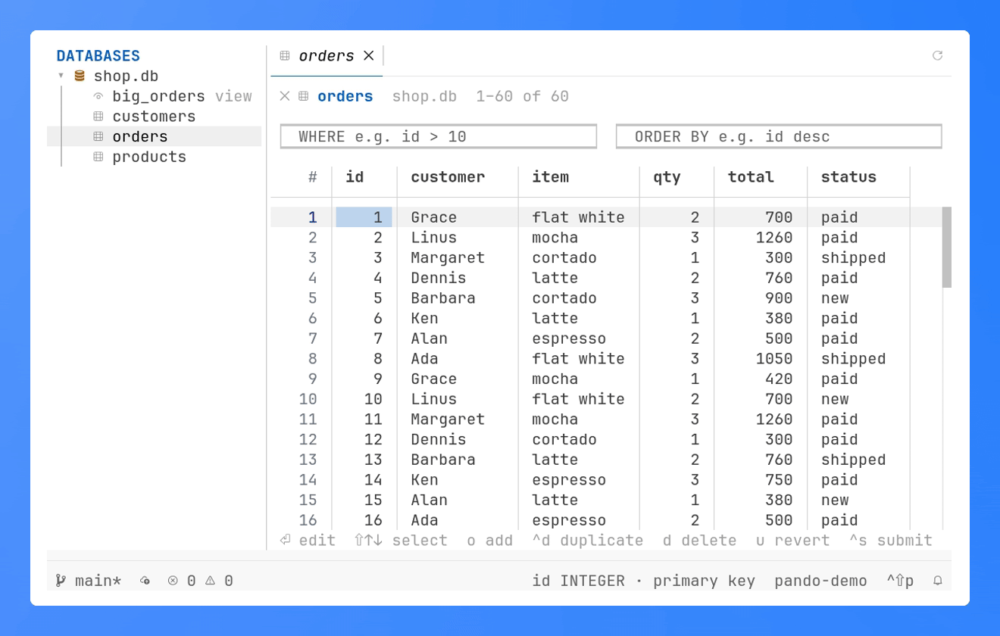

# Using pando

The user guide. Settings: [06-config.md](06-config.md); keys:
[09-keys.md](09-keys.md).

- [Projects, worktrees, sessions](#projects-worktrees-sessions)
- [The screen](#the-screen)
- [Sessions](#sessions)
- [Resume](#resume)
- [Review and commit](#review-and-commit)
- [GitHub](#github)
- [Databases](#databases)
- [Editor](#editor)
- [Settings, keys, updates](#settings-keys-updates)
- [CLI](#cli)
- [Instances](#instances)
- [Files](#files)

## Projects, worktrees, sessions

Spaces (`3`) is a tree: projects you added, their worktrees, and the
sessions in each worktree.

```text
app                      project: pando ~/code/app, or `a` in Spaces
├─ ⌂ main                its own checkout
│  ├─ ○ shell            session: idle
│  └─ ◐ claude           session: working
└─ ⑂ feat-login          linked worktree, `w`
   └─ × claude           session: waits for you
```

A project whose only worktree is its own checkout shows it on its line,
`app  ⌂ main`, its sessions right under it; a click on the branch switches
to it. An idle session says how long it has been idle (`3h`). Projects with
no session wait under _No Sessions_ at the bottom, a dimmed line each: a
click switches to it, `n` starts a session in it. Scrolled down, the
project of the top row stays on the first line.
A worktree with two sessions or more has a split button on hover: its
sessions open side by side, a group each.

| Key      | In Spaces                                                                 |
| -------- | ------------------------------------------------------------------------- |
| `a`      | add a project from the folder picker: places, folders, a path             |
| `w`      | add a worktree to the selected project                                    |
| `n`      | start an agent or a terminal in the worktree, or a row's `+`              |
| `x`      | kill a session, delete a worktree or close a project; a row's `✕` too     |
| `o`      | filter, sort and group the list                                           |
| `alt+↑↓` | reorder sessions and worktrees                                            |

A session runs an agent: the picker lists the installed `[agents]` presets
(claude, codex, gemini, agy, grok, opencode, …), then _terminal_, a plain shell. An
agent with profiles asks which one next: _default_, the `[profiles]` in
`config.toml`, then every config pando saw it run in, such as a claude
started as `CLAUDE_CONFIG_DIR=~/.claude-work claude` in a session.

```toml
[profiles.claude]
work = ["CLAUDE_CONFIG_DIR=~/.claude-work"]

[profiles.codex]
client = ["CODEX_HOME=~/codex-client"]
```

A project's `+` asks for one of its worktrees, or a new one, first. The
agent exiting closes its session; a failure stays listed as `exit N`.

Deleting a worktree keeps its branch; closing a project never removes its
checkout.

## The screen

```text
┌────────┬────────────────┬──────────────────────┬──────────────────┐
│ SPACES │ Files Git ⌕    │ main.go │ notes.md   │ claude           │
│ ▾ app  │ ▾ src          │                      │                  │
│  ⌂ main│    main.go   M │   editor or diff     │   session        │
│   ◐ fix│                │                      │   (its own PTY)  │
│  ⑂ feat│                ├──────────────────────┴──────────────────┤
│   × ui │                │ Terminal panel                          │
├────────┴────────────────┴─────────────────────────────────────────┤
│ status bar: branch, sync, agents waiting, updates                 │
└───────────────────────────────────────────────────────────────────┘
```

- `ctrl+]` cycles focus, through each editor group too; inside a session every
  other key goes to its program.
- `1`–`4` and `6` open Explorer, Source Control, Spaces, Search and GitHub.
- ``ctrl+` ``, `ctrl+j` or `5` toggles the bottom panel; `ctrl+shift+↑`
  maximizes it. Its tabs: Terminal (`+` a new shell, the select beside it picks
  one or kills it),
  Problems (`ctrl+shift+m`) and Output
  (`ctrl+shift+u`: the language servers' logs and every error in full).
- Editor groups, as VS Code's: drag a file's or a session's tab to a group's
  edge to split it there, onto its middle or tab strip to move the tab in.
  With two groups or more side by side, the very bottom of the editor
  area's middle puts it in a new row under them all.
  A file dragged from Explorer, or a session of the worktree in view from
  Spaces, goes the same way.
  `ctrl+\` moves the active tab into a new group on the right; the palette
  moves it into the group left, right, above or below. `ctrl+1`…`ctrl+9`
  focus group N, the button at the right end of a group's tab strip maximizes
  it. Adding or closing a group shares the room out evenly again; a double
  click on a divider evens the two groups beside it. In a split the focused
  group's frame is drawn in the accent's shade; a group whose session waits
  for you or failed is framed red, one that finished in the attention color,
  pulsing until you focus it. A group left empty closes; one showing nothing
  closes with `ctrl+w` or `ctrl+d`. Each worktree keeps its groups, a restart
  too.
- Drag a view's tab to move it, a divider to resize. A second click on the
  open view's icon hides its sidebar; `ctrl+b` hides both.
- Drag any tab of the bottom panel to a sidebar's tabs and the whole panel moves
  there, or to the sidebar's outer half for a column of its own; its tab dragged
  to the bottom of the editor brings it back. Nothing else goes there. Closed
  in a sidebar it keeps its tab, which opens it.
- Rest the pointer on an icon button for its name and key, or on a session
  whose name is cut for the whole of it (Settings' _Tooltips_ turns that
  off). A view's header buttons show for a few seconds after the pointer
  moves over the view.

## Sessions

- A session opens as a tab in the focused editor group, beside your files'
  tabs, or shows the group that has it already. Drag its tab to a group's
  edge to put it beside a file, or along the strip to put it between files'
  tabs (`ctrl+shift+pgup`/`pgdn` too). Its ✕ hides it; it keeps running. A
  session on screen keeps its tab when you switch to another or open a file,
  also one a worktree switch or a restart brought back.
- The `+` after a group's last tab, or `alt+n`, opens a file (as `ctrl+p`), one of the
  space's sessions, a new session, or a resumed one; `alt+s` goes straight to a
  new session.
  The empty editor area has the `+` too, and lists which keys work from
  anywhere and which need it focused.
- A session re-roots Explorer and Source Control to its worktree; Explorer
  selects the file its editor shows and comes to the front of its column
  (`auto_reveal`), as for any file or change opened, or tab picked. A file
  opened from Search or Source Control sharing Explorer's column leaves that
  view in front.
- Each session is one tab; the sessions of a worktree share its Terminal
  panel's shells, which outlive them. `alt+t` picks a session, `alt+a` goes to
  the next one waiting on you. An agent started in a shell, claude typed at its prompt,
  shows its state on the tab.
- Drag over a terminal to select and copy; `ctrl+f` finds in its scrollback.
- Ctrl+click a link in a terminal, as in VS Code's: a URL or an OSC 8
  hyperlink opens in the browser, a path (`app.go:12:5`, `app.ts(12,5)`,
  Python's `"x.py", line 12`) in the editor at that line. A relative path
  starts from the directory of the program in front (on Linux), else from
  the worktree; one found in neither (`go test`'s `x_test.go:42`, `rg -l`'s
  `ui/app.go`) opens the one file whose path ends in it, else quick open
  lists them. The pointer over a link underlines it.
- The subagents a claude, codex, agy or grok session runs list under its row in
  Spaces while they work: their kind (codex: the name it gave the agent)
  and what they do. They live inside the session; a
  click on one opens the session.
- `p` in Spaces, the `⊙` left of a session's row or its right-click menu
  pins it: Spaces lists it in the Pinned pane on top, and in its tree as
  before.

| Mark | State     | Means                                                     |
| ---- | --------- | --------------------------------------------------------- |
| `×`  | `blocked` | waits for you: a permission or a question                 |
| `◐`  | `running` | works; it turns while it does                             |
| `◐`  | `shell`   | running a shell command, in the background too (blue)     |
| `✓`  | `done`    | finished, not looked at yet                               |
| `○`  | `idle`    | at its prompt                                             |
| `◌`  | `asleep`  | stopped to free memory; opening it brings it back         |
| `✕`  | `exited`  | failed (`exit N`); a clean exit closes the session        |

One needing you pulses until clicked (`session_highlight`) and can
play a sound (`sounds`).


## Resume

After a daemon restart pando types into each session's shell what resumes
its agent: `claude --resume` with its conversation id (`claude --continue`
without one), `codex resume --last`, `opencode --continue`. Others take one
line:

```toml
[resume]
aider = ["aider", "--restore-chat-history"]
```

- A conversation still open elsewhere is not opened twice.
- A custom config dir (`CLAUDE_CONFIG_DIR`, `CODEX_HOME`) comes back with it.
- Scrollback is not kept, and what ran in the terminal stops, subagents
  included. `pando claude` starts claude as a Claude Code background session,
  which outlives the restart; with `claude_background` (the default) every
  resumed claude comes back that way.
- By hand: _Resume_ in Spaces (a worktree's row under the pointer, its menu,
  or `↺` in the header) lists that worktree's claude conversations
  (`claude --resume`); an agent without such a list continues its last.


## Sleep

An unused session can stop to free its memory: a claude takes 300–600 MB,
its background job and its `claude attach` together.

- `z` in Spaces, or _Sleep Session_ in a session's menu, puts it to sleep;
  working, it asks first. `pando session sleep ID` too.
- `sleep_after = 120` in `config.toml`, or _Settings → Sessions_, does it on
  its own to a session idle and unused that long: nobody typed into it,
  looked at it or saw it change. Blocked, working, finished but not looked
  at yet (`✓`), or running something pando would not bring back, it stays
  awake.
- Asleep (`◌`), its screen stays, its process and a claude's background job
  are stopped. A daemon restart leaves it asleep. A Terminal panel's shell
  sleeps on its own, idle at its prompt.
- Opening it, or a key typed into it, wakes it: the conversation is resumed
  as after a restart. A shell wakes to a new shell; a server or an editor
  that ran in it does not come back.
- codex (`resume --last`) and opencode (`--continue`) continue the latest
  conversation in the worktree: two of one in the same worktree can swap.
  gemini, agy and grok, with nothing in `[resume]`, are not put to sleep.

## Review and commit

Source Control (`2`) follows VS Code: Merge / Staged / Changes / Untracked,
a message box, and drawers for the graph, commits, file history, branches,
worktrees, remotes, stashes and tags. A commit in a drawer shows its whole
message when the mouse rests on it; right click copies it. The header's
Collapse All button closes the drawers with the tree. The drawers sit under
a TOOLS strip, as NO SESSIONS in Spaces: a click on it folds them into it, and
another brings them back as they were. With the mouse over the drawers, ⊟ on
the strip closes only the drawers.

⏎ on a commit lists the files it changed in the Compare drawer, read-only,
as GitLens does; ⏎ on a file opens its diff. A commit's right-click menu
compares it with HEAD, with the working tree, or with a commit picked by
_Select for Compare_; _Open Changed Files_ on a pull request in GitHub does
the same for the pull request. The empty drawer, or its header's right-click
menu, compares the branch with a branch or tag picked from a list, or with any
revision typed into it, as GitLens' _Compare with_ does. The ✕ on the
drawer's header clears it. Each project keeps its own comparison.

A diff shows the changes with three lines around them and the rest as `N
hidden lines` rows: ⏎ on one or a click shows those lines in place, and they
stay shown while the tab is open; find (`ctrl+f`) looks in them too and
unfolds the one with the match. `z` (or the header's fold button) shows a
file's whole diff, for every file until toggled back. `]` and `[` (VS Code's
`alt+F5`, `shift+alt+F5`, or the header's `↓` `↑`) go to the next and previous
change, `}` and `{` to the next and previous file: of a commit, or of Source
Control from a file's diff; a file's diff opens on its first change. The
scrollbar marks every change: green added, red deleted, yellow changed lines
(blue on the light theme); a click on a mark goes there, again to the next one
in the same cell.

| Key       | In Source Control                                          |
| --------- | ---------------------------------------------------------- |
| `⏎`       | stage or unstage the file; `o` opens its diff              |
| `a` / `u` | stage / unstage all; `U` stages the untracked              |
| `d`       | discard the file, folder or section, after asking          |
| `c`       | focus the message box; `A` has `claude` write the message  |
| `↑` / `↓` | in the message box: older / newer commit messages          |
| `C`       | commit                                                     |
| `S`       | sync, or publish a branch with no upstream                 |

In a diff, `s` switches inline and side by side, and selected lines stage,
unstage or revert (`m`). Side by side, a click picks the half the cursor
moves on, and a copy holds that half's lines only. The commit button turns into _Continue_ during a
merge, rebase or cherry-pick.


## GitHub

Shown when `gh` is on the `PATH` (`6`): Pull Requests with their checks,
Issues and unread Notifications for the repository `gh` picks.

| Key | Does                                                             |
| --- | ---------------------------------------------------------------- |
| `⏎` | renders a pull request or issue; opens a notification, read      |
| `d` | a pull request's changes, `gh pr diff`                           |
| `w` | a worktree for the pull request, or `issue/<n>-…` for an issue   |
| `o` | opens github.com; `y` copies the link                            |
| `x` | marks a notification done                                        |

Merge is in the `m` menu and merges only the head the list showed.

An opened pull request or issue has its state and buttons in the header row,
at the right end where VS Code puts an editor's actions: `● Open` (or Draft,
Closed, Merged), `✓ 2/2` checks, then buttons. One is first and has its name
and a `▾`, by state: Ready for Review for a draft, Merge while no check is in
its way, else Worktree, Reopen for a closed one. The `▾` lists Worktree,
Changes, Changed Files, Merge and Convert to Draft. The rest are icons: Worktree,
Changes, Comment, Close, `↻` fetches again and `⋯` is the `m` menu. Rest the
pointer on one for its name and key. Click one, or press its key while the page
has focus:

| Key      | Does                                                              |
| -------- | ----------------------------------------------------------------- |
| `w` `d`  | worktree, changes                                                 |
| `M` `R`  | merge, mark a draft ready for review                              |
| `c`      | puts the cursor in the comment box at the end of the page         |
| `x`      | closes an open pull request or issue, reopens a closed one        |
| `ctrl+r` | fetches the page again; every action does it when gh has answered |

Everything that changes the page asks first: merge (which says when its checks
are failing or still running), close, reopen, ready for review and back to a
draft. The title and the people are prompts, which the ⏎ confirms; a comment
is sent by its own button or `ctrl+s`.

At the end of the page is the box GitHub's has: Leave a comment, with Comment
and Close (or Reopen) under it. `c`, a click in it or Quote Reply puts the
cursor in it; ⏎ is a new line, `ctrl+s` sends, `esc` leaves the box with its
text, which stays there even when the page is closed and opened again. Close
with text in the box sends it as the comment of the close.

Reviewers, assignees, labels and the title are in the `m` menu: a prompt with
the current values, comma separated, that sends only what changed.

Under the header the page is laid out as GitHub's is: the description and each
comment in a box with its author and time across the top, the commits, review
requests and other events as rows on a vertical rail, a review with what it
said and the threads it started on a file under it. Every box has the same
frame; one that tags you (`@login`, as `gh` knows you) has a yellow one and
says "mentions you" in its header. In a panel 110 cells wide
or more (the sidebars hidden with `ctrl+b`, or a wide terminal) the reviewers,
assignees, labels and checks stand in a column beside it, each with a gear that edits it; in a
narrower one they are rows above.

| Click or `⏎` on | Does                                         |
| --------------- | -------------------------------------------- |
| a commit        | shows it, fetching the head first if needed  |
| a box's header  | folds the comment, again unfolds it          |
| the `⋯` of one  | Quote Reply, Fold, Open on GitHub, Copy Link |
| a gear          | the prompt of its section                    |

What was fetched stays in memory: a page or a diff seen in the last five
minutes shows at once without asking GitHub, an older one is fetched again
behind it, and so is a list older than five minutes; `ctrl+r` or any action
fetches at once. A page shown from memory says how old it is beside Refresh.


## Databases

Shown when `sqlite3`, `psql` or `mariadb` (or `mysql`) is on the `PATH`
(`7`): the SQLite files of the worktree, ignored ones too, the server its
`.env`'s `DATABASE_URL` names, and the servers you name in config.toml, each
unfolding to its tables and views. Opening a `.db` in Explorer or quick open
shows it there.

```toml
[databases]
local = "postgres://app@localhost:5432/app"
shop  = "mariadb://root@127.0.0.1:3306/shop"
```

`n` (or `+` in the view's header) adds one in a form, as DataGrip's Data
Source: type, host, port, user, password, database and options
(`sslmode=require`); `ctrl+t` tests it, `⏎` saves it to `[databases]`. `e`
edits one, `D` removes it. Save: Forever keeps the password in the system
keyring (GNOME Keyring, KWallet, macOS Keychain), Until restart only while
pando runs; the form never writes one into config.toml, and one you wrote
into a URL yourself stays there. Without one, a password in `~/.pgpass` or
`~/.my.cnf` works too, and pando asks when the server wants one. `t` opens
the client itself (`psql`, `mariadb`, `sqlite3`) in the Terminal panel, for
any other SQL.

A table opens in an editor tab as a grid, 200 rows a page, `[` `]` for the
next ones. Type SQL into WHERE (`ctrl+f`) and ORDER BY (`tab`) and press `⏎`;
`s` or a click on a column's header sorts by it. A server table of more than
100 000 rows shows the server's estimate, `~N`, until Count Rows counts them;
`esc` stops a slow read. The status bar names the cursor's column and type.
MariaDB timestamps show in UTC.

| Key              | Does                                                      |
| ---------------- | --------------------------------------------------------- |
| `⏎`              | edits the cell; a long or multi-line one in an editor tab |
| `o` `ctrl+d` `d` | adds, duplicates, deletes a row                           |
| `u`              | reverts the cell, else a deletion or an added row         |
| `ctrl+s`         | submits every edit in one transaction                     |
| `m`              | Set NULL, Revert All, Show Pending SQL, Open Console      |

`shift+↑` `shift+↓` select rows: `d`, `u`, `y` (as TSV) and Set NULL then take them all.

Edits wait, marked `M`, `A` or `D`, until `ctrl+s` writes them all or none.
A cell someone changed since the page was read stops the submit (a Postgres
table without a primary key: any change to its row), and so does a row gone;
`u` reverts the edit and `r` reads the row as it is now. A view, a generated
column and a blob are read only.



## Editor

- Undo, find & replace, quick open (`ctrl+p`, recent files first,
  `:` line, `@` symbol), suggestions, merge-conflict _Accept_ actions.
- The cursor's line is lit faintly across the editor, as VS Code's.
- `ctrl+/` comments the line or the selection out, and a second time back in,
  in the language under the cursor (a `<script>`, a code fence); HTML, CSS
  and Markdown get a block comment.
- The gutter marks the lines changed since the file was staged, as VS Code's
  does, while you type, in a thin bar before the line numbers: `▎` green added,
  yellow modified (blue on the light theme), `▾` red where lines were deleted;
  staged changes in a darker shade until committed; the scrollbar marks them
  too, under the problems, a click on a mark going there. The change under the
  pointer widens; a click on it (or `alt+F3`, `shift+alt+F3`) opens VS Code's
  quick diff right under it, scrolling with the text: the change as a diff,
  its buttons staging it, reverting it in the editor, going to the next and
  previous; a second click on the mark or `esc` closes it. `alt+F5` goes to
  the next change.
- Indent guides as VS Code draws them: a `│` at each indent level, the block
  around the cursor's lit (`indent_guide`), a file indented by 2 spaces
  getting one every 2 cells.
- A file's path shows under its tab (`breadcrumbs`); click a folder to browse
  it, ⏎ opens a file or unfolds a folder.
- `ctrl+shift+v` renders Markdown, `alt+v` beside the source.
- A file opened from Explorer, Search or Source Control takes the preview
  tab, in italics, which the next one replaces; an edit or a double click
  (on the file or the tab) keeps it, as in VS Code.
- Code folds by indentation: `▾` beside every block while the pointer is
  over the line numbers, a click (or `ctrl+shift+[` `]`, `zc` `zo`) folds it
  behind `⋯`; the cursor steps over a folded block, a jump into one opens it.
- `vim_mode = true` adds motions, operators and visual mode.
- Unsaved text is kept as a draft and comes back with its tab; a file changed
  on disk is never overwritten silently.
- `ctrl+shift+i` formats, `ctrl+s` too with `format_on_save`. Go uses `gofmt`,
  a file with no `[format]` tool its language server.
- Indentation follows the file: its `.editorconfig`, else what its lines show,
  else `tab_size` and `insert_spaces`; the status bar's Tab Size opens a
  dialog that changes the file's own (Auto goes back to what the file says).
- The status bar names who last changed the cursor's line and when (`Not
  Committed Yet` for a line typed since); a click opens the commit.


**Language servers.** `F12` definition, `shift+F12` references, `ctrl+.` code
actions, `F2` rename, `ctrl+shift+o` symbols, completions, the hover (the
pointer resting on a name, or `ctrl+k`), parameter hints as you type a call.
Go and TypeScript work once `gopls` or `typescript-language-server` is on
the `PATH`; others go in `[lsp]` and `[format]`
([06-config.md](06-config.md#language-servers-and-formatters)).

**Problems.** With `lsp_diagnostics` (on by default) a file's server starts as
the file opens, and its errors and warnings show as VS Code shows them: wavy
underlines in the editor and in a working-tree diff, the one under the cursor
in the editor's footer, the one under the pointer in a tip, `✖ 2 ⚠ 5` in the
status bar, red or yellow names with a count in Explorer and Source Control,
marks on a file's scrollbar. `F8` / `shift+F8` go to the next and previous
problem; `ctrl+shift+m` (or a click on the counts) lists them all, worst
first, information and hints too, and keeps up while open; `ctrl+.` on a
squiggle offers its server's quick fixes. Source Control's changed files are
checked without being opened, 50 at most. A file whose server would not start
says `⚠ no diagnostics` in the status bar (its tip says why); a project with
no TypeScript of its own uses a TypeScript 7 `tsc` on the `PATH`. A daemon
started before this setting existed needs `pando stop` to know it.


## Settings, keys, updates

Settings live in `config.toml`, commented in the file. `ctrl+,` (or ⚙ →
Settings; ⚙ and `F10` open the Manage menu, every command by category)
opens them in a tab, its sections Appearance, Explorer, Source Control,
Editor and Sessions across the top, each setting a checkbox or a dropdown
that applies at once,
`pando set KEY VALUE` changes one from a shell, and every change applies live
in every attached TUI. Keys remap in its `[keys]` table, by command id
([06-config.md](06-config.md#keys)); every default key:
[09-keys.md](09-keys.md).

The cursor's shape and blink are your terminal's, so set them there; an app in
a session may change them, as it would outside pando.

The daemon checks GitHub once a day (`update_check`). A newer version shows
in the status bar; a click or `pando update` installs it, verified, for the
next start.

Without a Nerd Font installed, the status bar offers _Symbols Nerd Font Mono_
(Linux, macOS): a click downloads it from the nerd-fonts release, checks its
SHA-256, installs it for your user (on Linux with its fontconfig rule) and sets
`icons = "nerd"`; `×` stops the offer (`nerd_font_offer`). It is not offered
over SSH, where the font would land on the server, nor in kitty, WezTerm or
Ghostty, which bring the icons. A terminal already open may need a restart to
pick the font up.

## CLI

Every command talks to the daemon and prints JSON, bar `session read` (text)
and `project ls` (paths); `pando help` lists them.

```sh
wt=$(pando ws new feat-x --project . | jq -r .path)  # a new worktree
pando session new --agent claude --ws "$wt" --name fix --wait
pando session send fix 'fix the failing test' --wait
pando session wait fix --until blocked --timeout 60000
pando session read fix --lines 120
pando call METHOD '{"json":"params"}'                # raw API
```

`pando FILE:LINE:COL` opens the project holding FILE with the file at that
place, as compilers print it; `pando open FILE:LINE:COL` shows it in the
TUIs already open.

`--wait` blocks until the session is idle, blocked or exited, so nothing
polls. The API covers sessions, workspaces, projects and settings; diffs and
commits are git's. A session gets `PANDO_SESSION`, so an agent inside one can
drive pando too: `pando skill` prints [the agent guide](../skills/pando/SKILL.md).
Inside one, a pando terminal's shell too, `pando` and `pando DIR` refuse to
open a second TUI in the first; `pando FILE[:LINE]` opens the file in it.

## Instances

`pando --instance work` opens a separate pando: a daemon, projects and
sessions of its own, the same `config.toml` and data directory. The first
start creates it; the status bar names it.

```sh
pando --instance work                # the TUI, in instance work
pando --instance work session ls     # any command, in it
pando instance ls                    # every instance, running or stopped
pando --instance work stop
```

A session's own `pando` commands reach the instance it runs in;
`--instance default` reaches the default one. `PANDO_INSTANCE=work` does
what `--instance work` does, except inside a session, whose
`PANDO_RUNTIME_DIR` wins. To forget an instance, stop it and remove
`~/.config/pando/instances/work`.

## Files

| Path                                       | Holds                                     |
| ------------------------------------------ | ----------------------------------------- |
| `$XDG_RUNTIME_DIR/pando/`                  | `pando.sock`, `daemon.log`                |
| `~/.config/pando/config.toml`              | settings, agent presets                   |
| `~/.config/pando/state.json`               | projects, open editors, session specs     |
| `~/.local/share/pando/worktrees/`          | worktrees created by pando                |
| `~/.local/share/pando/drafts/`             | unsaved editor text                       |
| `$XDG_RUNTIME_DIR/pando/instances/NAME/`   | instance NAME's socket and log            |
| `~/.config/pando/instances/NAME/`          | instance NAME's `state.json`              |

On macOS the config lives in `~/Library/Application Support/pando`.
`PANDO_RUNTIME_DIR`, `PANDO_CONFIG_DIR` and `PANDO_DATA_DIR` override them.
